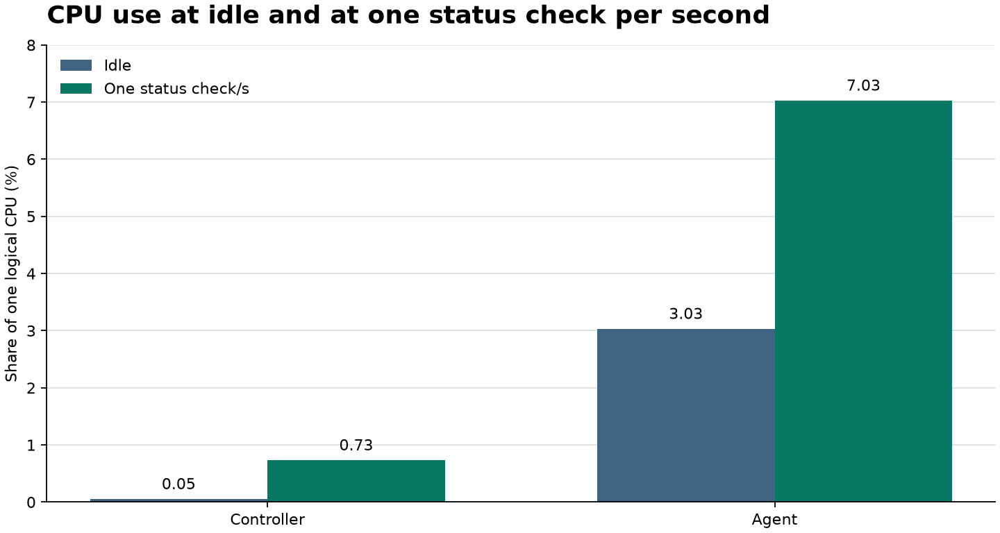

# HLCP — řízení služeb v HomeLabu

Martin Goffa · ANI-COM · 18. listopadu 2026

[Kód projektu](../README.md) · [Podklady k měření](data/final-agent-720dcad/README.md) · [Anglická verze](report.md)

## Abstrakt

V HomeLabu provozujeme dvě aplikace v několika kontejnerech. Abychom je mohli spravovat z jednoho místa, vytvořili jsme HomeLab Control Plane (HLCP). Přes jeho rozhraní lze najít správný kontejner, sledovat logy a spustit povolenou akci. Na testovacím kontejneru trval dotaz na stav v mediánu 80 ms a restart 165 ms. Nové SSH spojení zabralo u obou úloh víc času, sdílené SSH bylo o něco rychlejší. Při jednom dotazu za sekundu agent využíval přibližně 7 % jednoho logického jádra.

## 1. Problém a výzkumná otázka

Jedna z našich aplikací běží ve třech kontejnerech, druhá v jediném kontejneru na stejném uzlu. Při hledání závady může správce vybrat kontejnery podle tagu aplikace a ve webovém rozhraní otevřít log konkrétní služby. Stejný inventář a povolené akce nabízí také CLI. Když správce požádá o restart, dostane ID příkazu, podle kterého může později dohledat výsledek.

Zajímalo nás, kolik času přidá cesta přes kontroler při zjištění stavu nebo restartu oproti SSH a co správce zjistí při výpadku agenta či zamítnutí požadavku. Na vyhrazeném kontejneru jsme měřili dobu provedení příkazu přes CLI. Rychlost webového rozhraní a zkušenost uživatelů by vyžadovaly samostatné měření.

## 2. Co jsme vyvinuli a nasadili

Když se objeví problém s aplikací, obvykle začínáme u logů. V HLCP vyfiltrujeme kontejnery podle tagu a v prohlížeči otevřeme výstup služby, která nás zajímá. Stejné kontejnery vidíme i z příkazové řádky. Na testovacím kontejneru jsme ověřili, že lze sledovat nové řádky za běhu a načíst poslední výstup i po jeho zastavení.

U běžící aplikace jsme přes HLCP ověřili stav kontejneru. Start, zastavení a restart závisí na tom, jaké akce pro kontejner správce povolil. Restart jsme při měření ověřovali na vyhrazeném kontejneru.

### Jak příkaz projde systémem

[HLCP Web](https://github.com/goffamartin/hlcp-web) i CLI posílají požadavky kontroleru. Kontroler ověří oprávnění a předá příkaz agentovi, který běží na stroji s kontejnery. Při dotazu na stav agent požádá přímo Podman o aktuální stav kontejneru. Kontroler uloží výsledek pod ID příkazu, takže se k němu správce může vrátit později. Pokud agent po provedení akce spadne dřív, než stihne uložit výsledek, může výsledek zůstat neznámý.

## 3. Jak jsme měřili

Kontroler i agent běžely na samostatných virtuálních strojích se dvěma logickými jádry. Pro všechny varianty jsme použili stejný testovací kontejner a stejný účet na agentovi. Před měřením jsme si v krátkém pilotu ověřili, že všechny tři varianty fungují.

- **Stav a restart.** Porovnali jsme HLCP, SSH s novým spojením pro každý příkaz a SSH se sdíleným spojením. Po zahřátí jsme v každé variantě změřili 300 dotazů na stav a samostatně 30 restartů. Pořadí variant se v každém bloku měnilo. Měřili jsme dobu od spuštění příkazu do jeho návratu. Po každém restartu jsme zvlášť ověřili, že stejný kontejner běží a má nový čas startu.
- **Spotřeba.** CPU a paměť obou služeb jsme sledovali ve třech dvouminutových oknech v klidu a třech při jednom dotazu na stav za sekundu. Paměť zahrnuje celou skupinu procesů služby.
- **Obnova a oprávnění.** Na dočasné instalaci jsme agenta pětkrát ukončili a znovu spustili a pětkrát pozastavili s otevřeným spojením. Sledovali jsme, kdy kontroler výpadek zaznamenal a kdy znovu prošel dotaz na stav. Ve třech samostatných sériích jsme také zkoušeli neplatné přihlašovací údaje, nepovolenou akci a práci s výsledkem příkazu.

V tabulce latencí uvádíme medián a p95. Hodnota p95 říká, do jakého času doběhlo alespoň 95 % úspěšných pokusů. [Skripty a naměřená data](data/final-agent-720dcad/README.md)

## 4. Výsledky

### Živý stav a restart

| Úloha a způsob provedení | Úspěšné / celkem | Medián (ms) | p95 (ms) |
|---|---:|---:|---:|
| Stav · HLCP | 300/300 | 80,29 | 92,54 |
| Stav · nové SSH | 300/300 | 179,10 | 192,59 |
| Stav · sdílené SSH | 300/300 | 66,69 | 74,81 |
| Restart · HLCP | 30/30 | 165,31 | 191,24 |
| Restart · nové SSH | 30/30 | 272,37 | 301,17 |
| Restart · sdílené SSH | 30/30 | 159,41 | 199,46 |

Nejvyšší medián mělo u obou úloh nové SSH spojení. Sdílené SSH bylo v mediánu rychlejší než HLCP o 13,60 ms u stavu a o 5,90 ms u restartu. Při restartu mělo HLCP p95 o 8,22 ms nižší než sdílené SSH. U všech 90 restartů nezávislé čtení potvrdilo stejný kontejner, nový čas startu a stav `running`. Připravenost aplikace přijímat požadavky by vyžadovala vlastní sondu.

### Spotřeba při pravidelném dotazování

| Služba | CPU v klidu (%) | CPU při 1 dotazu/s (%) | Paměť při zátěži, medián každého běhu (MB) |
|---|---:|---:|---:|
| Kontroler | 0,052–0,054 | 0,47–1,01 | 12,08 / 15,18 / 16,21 |
| Agent | 3,00–3,03 | 6,90–7,11 | 12,49 / 13,46 / 13,50 |

Všechny tři série dokončily 160 ze 160 naplánovaných dotazů. Procenta CPU jsou průměry za jednotlivá 120sekundová okna vůči jednomu logickému CPU. Paměť udává spotřebu účtovanou celé cgroup služby. Nejvyšší zaznamenaný vzorek agenta při zátěži činil 14,07 MB.

[Graf využití paměti](figures/service-memory.png)

### Obnova a pravidla přístupu

Při řádném ukončení agenta kontroler zaznamenal stav offline v mediánu za 8,26 ms. Po novém spuštění přišla první odpověď na dotaz za 107,69 ms v mediánu. [Data z řádného ukončení](data/final-agent-720dcad/clean/samples.csv)

Při tichém výpadku jsme pětkrát po sobě pozastavili stejný proces s otevřeným spojením. Kontroler zaznamenal stav offline v mediánu za 15,03 s od pozastavení. Čas do nového spojení jsme měřili od chvíle, kdy jsme agenta nechali znovu běžet. Po prvním pozastavení to trvalo 0,97 s a po pátém 15,80 s. Po každém připojení prošel také dotaz na stav. [Data z opakovaných přerušení](data/final-agent-720dcad/silent/samples.csv)

Agent záměrně prodlužuje prodlevu po krátkých spojeních, aby při opakovaných výpadcích nezkoušel připojení příliš často. Po alespoň minutě stabilního spojení se prodleva vrátí na výchozí hodnotu. V této sérii další pozastavení následovalo krátce po úspěšném dotazu, takže se prodleva mezi pokusy zvyšovala.

TLS odmítlo spojení bez klientského certifikátu i s certifikátem od cizí autority. API vrátilo 401 při chybném tokenu, 422 při nepovoleném restartu a 409 při opětovném použití ID pro odlišný příkaz. Dohledání i zopakování původního požadavku vrátilo shodný výsledek. Všechny tři nezávislé série poskytly očekávané odpovědi.

## 5. Závěr

HLCP v našem HomeLabu zjednodušilo běžný postup při kontrole služby. Z jednoho místa můžeme najít správný kontejner, podívat se do logu a zjistit, jak dopadla povolená akce. Kontroler a agent se ověřují certifikáty a správce může spouštět jen povolené akce. Po přerušení se agent znovu připojí a správce může dohledat uložený výsledek. Proti sdílenému SSH přidalo HLCP v mediánu přibližně 14 ms u stavu a 6 ms u restartu. Při jednom dotazu za sekundu využíval agent asi 7 % jednoho logického CPU a jeho mediány paměti byly 12,49 až 13,50 MB.

Latenci jsme měřili na jednom kontejneru a dvojici virtuálních strojů. Obnovu spojení jsme zkoušeli místně na jednom stroji a spotřebu sledovali v krátkých intervalech. Výsledky tak popisují běžné úkony v našem prostředí.

## Zdroje

1. OpenBSD, [ssh_config(5)](https://man.openbsd.org/ssh_config).
2. E. Rescorla, [TLS 1.3, RFC 8446](https://www.rfc-editor.org/rfc/rfc8446.html), 2018.
3. C. Bormann a P. Hoffman, [CBOR, RFC 8949](https://www.rfc-editor.org/rfc/rfc8949.html), 2020.
4. Linux kernel documentation, [Control Group v2](https://www.kernel.org/doc/html/latest/admin-guide/cgroup-v2.html).
