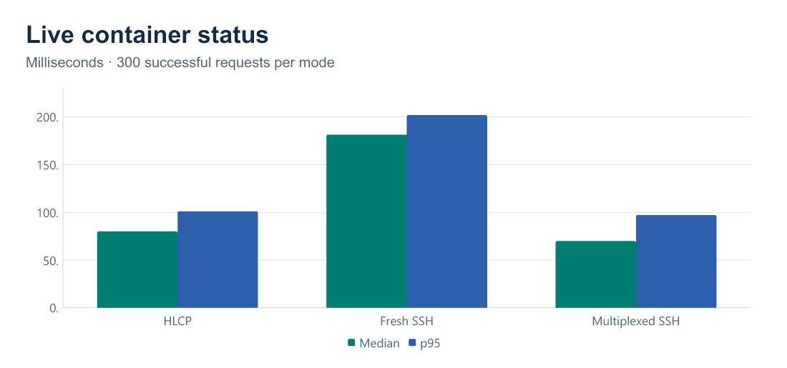
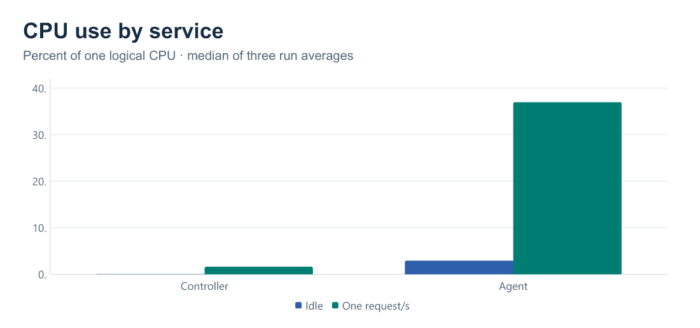
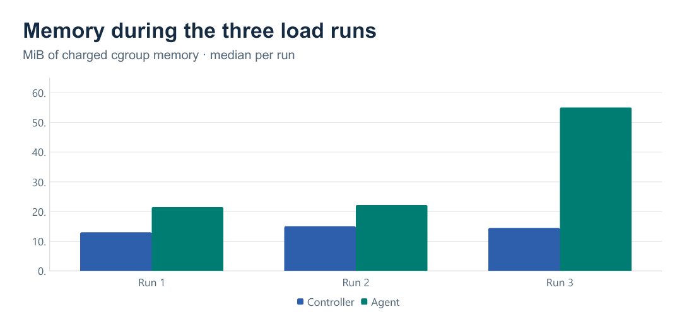
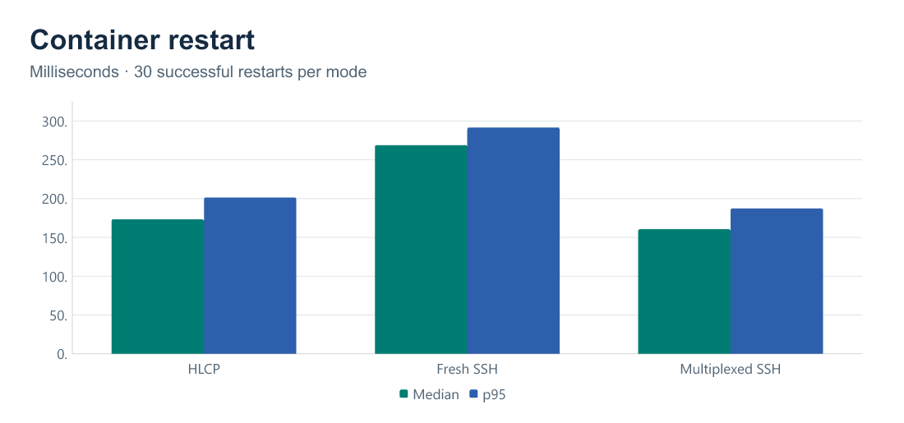
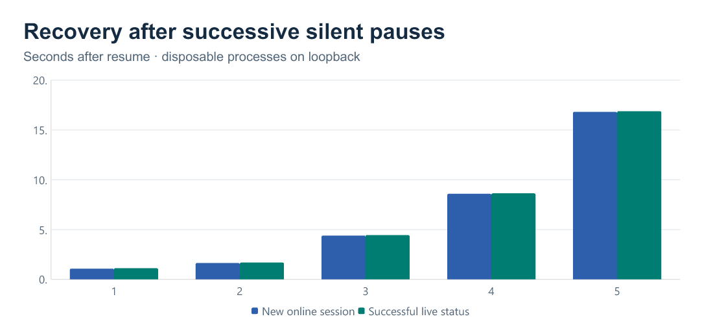

# HLCP: controlled service management in a HomeLab

Martin Goffa — ANI-COM

16 November 2026

[Implementation at v1.1.0](https://github.com/goffamartin/homelab-control-plane/tree/v1.1.0) ·
[Evaluation scripts and data](https://github.com/goffamartin/homelab-control-plane/tree/codex/semester-evaluation/evaluation)

## Abstract

HLCP is a controller–agent application protocol for managing explicitly configured
HomeLab resources. The implementation provides resource discovery and named actions
through a central interface, with authenticated transport and persistent command
identifiers. This report examines its execution overhead relative to SSH and its
behavior during connection failures and rejected requests. For live status, the observed median was 80.02 ms for HLCP, 181.42 ms for fresh SSH, and 69.92 ms for multiplexed SSH. In five successive agent pauses, the test controller observed the node offline after about 15 seconds. The functional policy checks confirmed certificate and API request refusals under the tested configuration.

## 1. Problem and research question

A HomeLab can contain several services with different management commands and access
paths. SSH provides a flexible remote interface, but the operator still needs to know
the relevant host, runtime and command. HLCP exposes configured resources and their
allowed actions through a consistent controller interface. The implementation also
has a separate web client; the evaluation focuses on the core controller and agent.

The research question is: **What execution overhead does HLCP introduce compared
with direct SSH management, and how does it behave when connections fail or requests
violate its access policy?**

The study uses a real HomeLab with a controller VM and a Debian agent managing a
dedicated rootless Podman test container. It evaluates one topology and implementation
version. It does not establish a general usability advantage or universal security
guarantee.

## 2. Technical background

### Remote execution and connection reuse

SSH combines an authenticated encrypted connection with remote command execution.
Its performance depends partly on whether the client establishes a new connection
for each command. OpenSSH supports connection sharing through ControlMaster and
ControlPath, with ControlPersist controlling the master's lifetime [1]. The evaluation
therefore includes both fresh and multiplexed SSH. Comparing HLCP's persistent
agent connection only with fresh SSH would conflate connection reuse with application
protocol overhead.

### Transport authentication and application authorization

HLCP runs as an application protocol over mutually authenticated TLS. TLS protects
transport confidentiality and integrity and supports certificate authentication [2].
The application still needs to bind an authenticated identity to a node and decide
which resources and actions the caller may access. These checks belong to the
application policy; an encrypted connection alone does not grant permission to
restart a service. The controller's local management API has a separate credential
boundary from the controller–agent connection.

### Framing and data representation

A byte stream does not preserve application message boundaries. HLCP defines bounded
frames and typed messages for session setup, inventory, state, commands and results.
Its Go implementation uses CBOR, a binary data representation specified in RFC 8949
[3]. A compact representation can serve implementation goals, but this study does not
infer a wire-size or serialization speed advantage without a separate controlled
encoding experiment.

### Uncertain command outcomes

A caller can lose its connection after an operation starts and before the result
arrives. The missing response does not reveal whether the operation ran. HLCP assigns
a stable command identifier and persists command lifecycle information so a caller
can query the original result and duplicate requests can be recognized. An external
side effect and a journal update still have separate failure boundaries. A crash
between these steps can leave the outcome unresolved.

## 3. Implementation

The Go controller accepts authenticated agents and exposes a local HTTP management
API. Agents publish configured resources and available actions. The CLI resolves a
selected node/resource/action and submits a command with a stable ID. The agent
executes the corresponding local adapter and returns a structured result. The
resource allowlist bounds the remote interface; scripts are locally configured named
actions, rather than arbitrary shell text supplied by a remote caller.

The container adapter invokes Podman for live observation and lifecycle operations.
Resource status performs `podman container inspect` on the agent. Inventory and node
status read the controller's current snapshot, so they represent a different task.
The latency comparison uses a resource status action to match direct SSH inspection.

The agent/controller persistence mechanisms support deduplication and retained-result
lookup. The implementation exposes uncertain states when it cannot establish an
outcome. This behavior matters for mutation safety even if it adds execution overhead.

## 4. Experimental method

The [evaluation protocol](README.md) and [run register](data/results.md) contain
the procedures and measured data.

The operator supplied an initial environment inventory on 3 November 2026. Both
binaries report v1.1.0 revision `0f119514b1739652d709aee7b07db742d44dc0a0`, built with
Go 1.27.3 for Linux amd64. This is preparation evidence, not a performance result.

| Parameter | Controller | Agent |
|---|---|---|
| Available processors (`nproc`) | 2 | 2 |
| OS-visible total memory (`free -m`) | 1906 MiB | 1906 MiB |
| Podman | Not part of controller role | 5.4.2 |

The agent also hosts ordinary application workloads. These remain outside
the experiment's mutation targets but contribute normal background load. Whole-VM
used memory is separate from the cgroup measurements. Detailed host and
storage characteristics were not captured for the final runs. Source provenance is in
[the initial inventory](environment/2026-11-03-user-inventory.json).

The primary comparison measures CLI invocation to a validated terminal result on the
controller using a monotonic clock. The three paths are HLCP with an established agent
session, fresh SSH and SSH over an established master connection. All inspect the same
running test container under the same agent-side user. Warm-up samples are marked
separately. Mode order changes between repeated blocks with a recorded random seed.

Each attempted request was recorded. The tables summarize successful latencies
using the median and nearest-rank p95 and give the total sample count. The
measurement includes process startup, local API work, persistence, transport and
runtime work. It does not isolate network-only latency.

Service CPU and memory measurements cover idle and specified request loads, with
separate controller and agent accounting. Cgroup CPU time and memory are defined by
the Linux accounting interface [4]; charged cgroup memory must not be mislabeled RSS.
Recovery experiments distinguish clean disconnects from silent communication loss.
The policy experiment compares expected rejections and retained results with
observed API and TLS responses.

## 5. Results

### Live container status latency

The 16 November 2026 run recorded 930 observations: 30 warm-ups and 900 measured
requests across three blocks. Each mode had 300 successful measured requests and
zero failures or timeouts. The [original summary](data/e1-final-20261116T083722Z/summary.csv) was independently reproduced from the per-request samples for all three blocks and pooled results.

| Mode | Successful / attempted | Median (ms) | p95 (ms) |
|---|---:|---:|---:|
| HLCP | 300 / 300 | 80.02 | 101.09 |
| Fresh SSH | 300 / 300 | 181.42 | 201.84 |
| Multiplexed SSH | 300 / 300 | 69.92 | 97.13 |

Fresh SSH had 2.27 times the median latency of HLCP. HLCP's median exceeded
multiplexed SSH by 10.10 ms (14.4%). This ordering also held in each block.
The comparison measures the end-to-end invocation paths, so it cannot attribute
the differences to a single protocol component.

### Idle service resource use

Three paired 120-second runs yielded 121 samples per service per run. The recorded
UTC windows overlap by 117.1–118.2 seconds, assuming synchronized VM clocks.
The table summarizes the range across runs. CPU is expressed relative to one
logical CPU. Memory is sampled cgroup usage.

| Service | Mean CPU per run (%) | Median memory per run (MiB) | Highest sampled memory (MiB) |
|---|---:|---:|---:|
| Controller | 0.053–0.054 | 11.16–11.17 | 11.41 |
| Agent | 2.944–2.982 | 20.79–20.82 | 21.11 |

See the [per-run summary](data/e3-idle-summary.csv) and
[experiment register](data/results.md).

### Service resource use at one status request per second

All 480 scheduled requests succeeded across three runs. Each 120-second
service window contained 120 request starts. The paired windows overlapped
by 113.6–115.3 seconds according to VM UTC timestamps.

| Service | Mean CPU per run (%) | Median memory per run (MiB) | Highest sampled memory (MiB) |
|---|---:|---:|---:|
| Controller | 1.245–1.939 | 13.00–15.04 | 17.04 |
| Agent | 36.927–37.070 | 21.50, 22.16, 54.99 | 66.95 |

Agent CPU rose by about 34 percentage points of one logical CPU relative to
idle and stayed close to 37% across all three loaded runs. Agent memory had
substantially more variation. The third run started at 36.45 MiB and reached
66.95 MiB. The available cgroup counters cannot identify which processes or
memory categories account for the increase. All three runs are included.
See the [per-run summary](data/e3-load-summary.csv) for observed timings.

### Container restart latency

The E2 final run completed 90 restarts in three blocks with ten requests per
mode per block. All trials passed the checks for the same container identity,
running state and a changed start timestamp. The timed interval ends when
the restart command returns. The separate running-state check follows it
outside that interval. This workload uses an idle test container.

| Mode | Successful / attempted | Median (ms) | p95 (ms) |
|---|---:|---:|---:|
| HLCP | 30 / 30 | 173.18 | 201.27 |
| Fresh SSH | 30 / 30 | 268.74 | 291.44 |
| Multiplexed SSH | 30 / 30 | 160.50 | 187.27 |

HLCP's median was 95.56 ms lower than fresh SSH and 12.68 ms higher than
multiplexed SSH. The same median ordering held in all three blocks and
in the separate status experiment. The [restart summary](data/e2-final-20261116T115111Z/summary.csv) was verified against the original samples for all three blocks and pooled results.

### Recovery after a clean agent stop

Five trials ran with a disposable controller and agent over loopback on the
Debian agent VM. The observer saw offline after a median of 8.34 ms from the
stop request (range 8.00–16.32 ms). From relaunch, the median time to observe a
new online session was 52.48 ms (51.67–54.74 ms). The first successful live
status result arrived after a median of 103.29 ms (101.39–113.66 ms). These
observations include local process handling and polling granularity. The
[raw recovery samples](data/e4-clean-20261116T130119Z/) describe orderly socket
closure and relaunch on one host.

### Recovery after a silent agent interruption

Five successive trials suspended the same disposable agent process with its
socket still open. The controller observed offline after a median of 15.028 s
(15.024–15.034 s) from the pause request, consistent with its three missed
five-second heartbeat intervals. From resume, the median time to a new online
session was 4.397 s (1.074–16.816 s). The first successful status result
followed after a median of 4.447 s (1.116–16.882 s).
Reconnect delays increased across the successive trials. This is consistent
with the agent's reconnect backoff and its one-minute stable-session criterion
for resetting it. The immediate succession of trials matters when interpreting
the result. See the [timing samples](data/e4-silent-20261116T130404Z/).

### Functional access policy

In a separate disposable loopback run, a missing client certificate and a
certificate issued by an unrelated CA received TLS rejection alerts. The local
API rejected an invalid token (401), a restart outside the resource's allowed
actions (422), and a changed payload using an existing command ID (409).
A result lookup and a repeated status submission with the original ID returned
the previously observed result. This is one run per case. Matching responses
do not independently count adapter executions.
See the [observed responses](data/e5-policy-20261116T130605Z/policy.json).

## 6. Discussion and limitations

The median ranking in every latency block was multiplexed SSH, HLCP, then fresh
SSH. Connection setup matters in this comparison because HLCP and multiplexed
SSH reuse a connection. The measured gap also includes process startup and
application work such as action admission and result recording. The design does
not isolate the cost of each component or the effect of CBOR.

The agent's cgroup includes the Podman processes it launches. The measured CPU
therefore reflects the deployed service and its runtime work. Background workload
and charged memory may vary even at the same request rate. We kept the third
loaded memory series because we had no evidence of a measurement fault.

The LAN measurements characterize one VM pair and one container. The loopback
tests characterize process recovery under the stated heartbeat and backoff
configuration. The 30 restart samples per mode provide a descriptive p95
with limited resolution. Restart completion and the follow-up running check
do not measure application readiness. Policy results cover the tested cases once
and leave other configurations and guarantees outside the experiment.

## 7. Conclusion

HLCP completed both workloads faster than fresh SSH in this environment.
Relative to multiplexed SSH, HLCP added about 10 ms to the median live status
operation and about 13 ms to the median restart. At one status request per second
the agent service used about 37% of one logical CPU, compared with about 3% at
idle. The isolated recovery trials showed that clean socket closure was detected
quickly and that a silent interruption followed the heartbeat timeout. Repeated
brief interruptions increased time to reconnect. The policy trials verified
the tested trust and action boundaries and retained-result behavior.

## References

1. OpenBSD. *ssh_config(5).* https://man.openbsd.org/ssh_config (accessed 2026-11-03).
2. Rescorla, E. *The Transport Layer Security (TLS) Protocol Version 1.3.* RFC 8446,
   2018. https://www.rfc-editor.org/rfc/rfc8446.html. Original TLS 1.3 specification.
3. Bormann, C., Hoffman, P. *Concise Binary Object Representation (CBOR).* RFC 8949,
   2020. https://www.rfc-editor.org/rfc/rfc8949.html (accessed 2026-11-03).
4. Linux kernel documentation. *Control Group v2.*
   https://www.kernel.org/doc/html/latest/admin-guide/cgroup-v2.html (accessed 2026-11-03).
5. Goffa, M. *HomeLab Control Plane*, v1.1.0, implementation source.
   https://github.com/goffamartin/homelab-control-plane/tree/v1.1.0.
